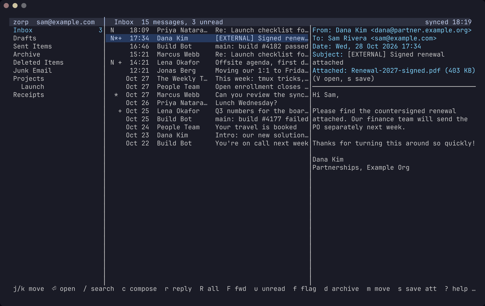
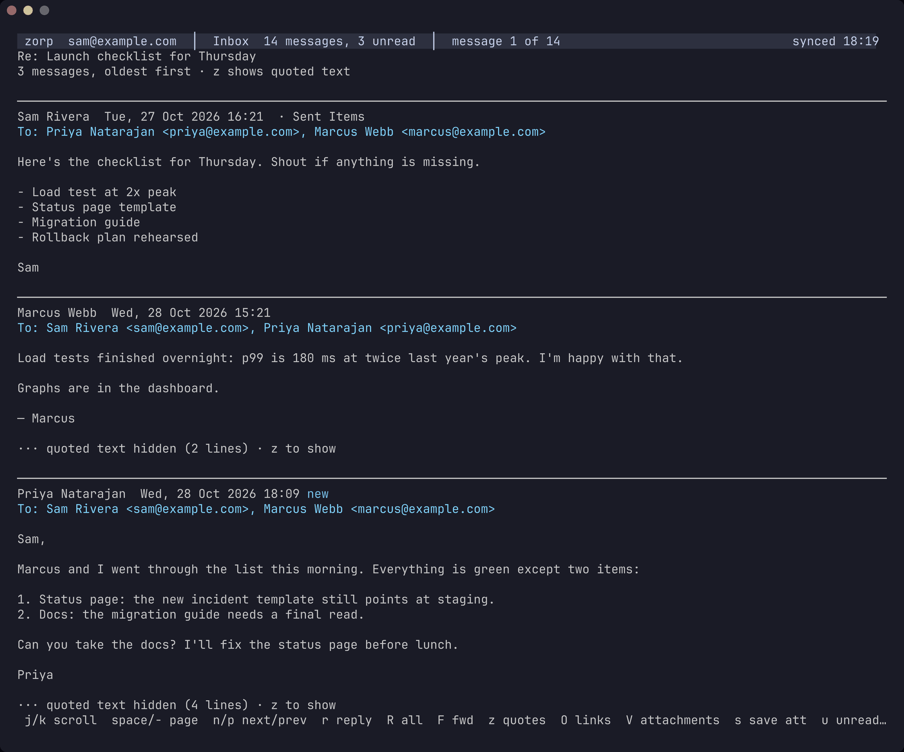
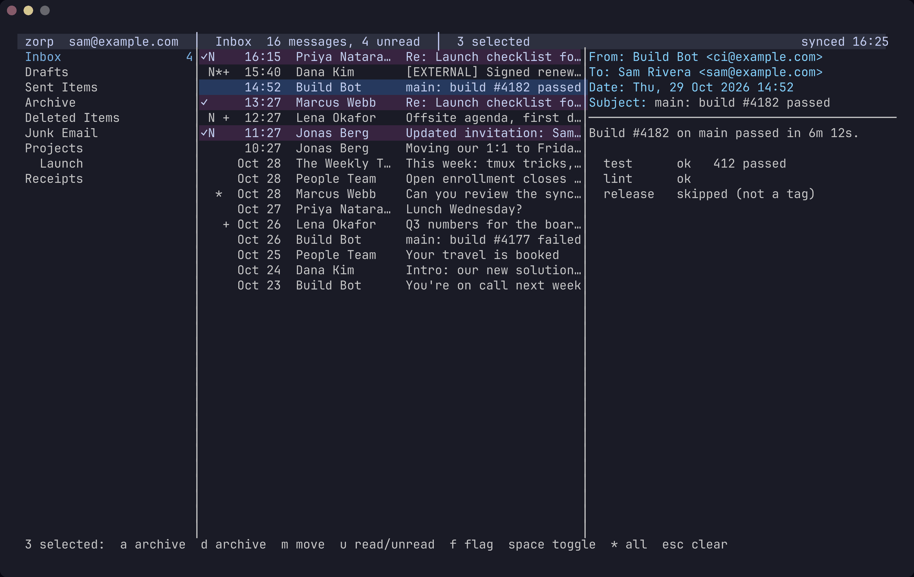
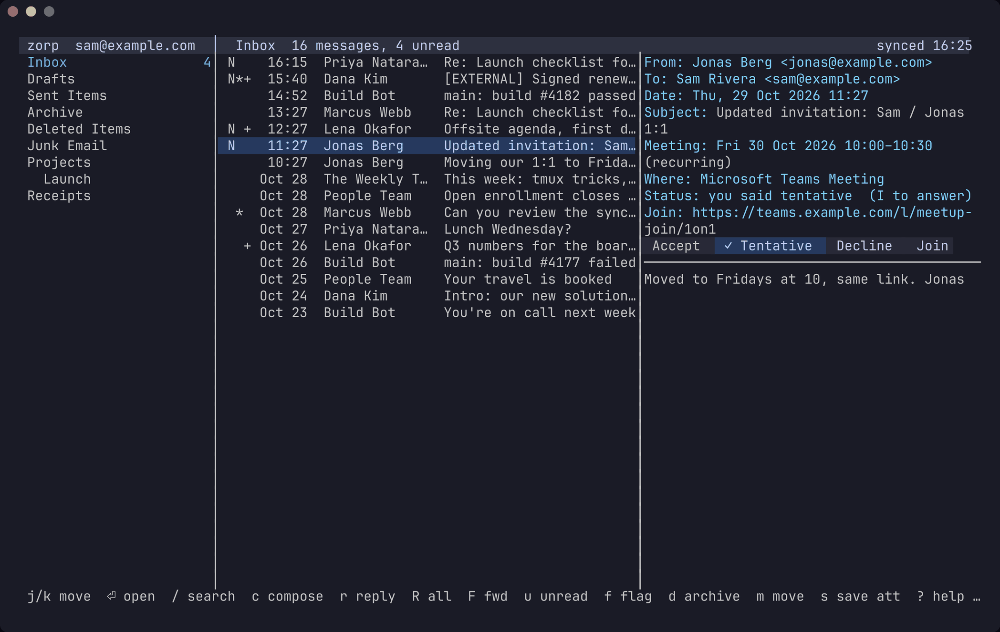

# zorp

A fast, keyboard-driven terminal mail client for Microsoft 365. It talks to Microsoft Graph directly (no IMAP), keeps a local cache so everything is instant, and feels like pine.



- **Three panes, pine-style keys.** Folders, the message list and a preview, with a full-screen reader. Drag the dividers to resize them, or move the preview to the bottom.
- **Mail as readable text.** HTML mail is turned into styled text, with links as numbered footnotes and reply history folded away. In kitty or Ghostty, inline images show up too. Remote images are never loaded.
- **Conversations.** `T` collapses the list into one row per conversation. Enter reads the whole thread, oldest first, including your replies from Sent Items.
- **Fast search.** Full-text search over the cache with `from:`, `is:unread`, `after:7d` and the like, falling back to a server search of the whole mailbox.
- **Write in your editor, in Markdown.** Mail is sent formatted, and you review it before it goes. Replies thread properly in Outlook.
- **Bulk actions.** Select messages with Space, or everything with `*`, then archive, move, mark or flag them all at once.
- **A sync daemon.** It keeps the cache current with delta queries, sends your changes in the background and shows new-mail notifications.
- **An MCP server.** `zorp mcp` lets AI tools like Claude Code read and search your mail. It is read-only unless you allow writes, and it can never send.
- **Your terminal's colours.** zorp matches your terminal theme, with soft 24-bit tints for the cursor and selection.

| Reading a conversation (`T`, then Enter) | Selecting messages for a bulk action |
|---|---|
|  |  |

The screenshots show made-up mail; `scripts/screenshots.sh` takes them.

**Status:** zorp is in daily use against a real Microsoft 365 mailbox, on Linux. It is a personal project: expect rough edges, and set up [guardrails](#safety-guardrails) while you try it out.

## Install

Release tarballs for Linux (amd64 and arm64) are on the [releases page](https://github.com/perlsaiyan/zorp/releases). With Go 1.26 or later you can also install from source:

```sh
go install github.com/perlsaiyan/zorp/cmd/zorp@latest
```

Either way, you need your own [app registration](#app-registration) before you can sign in. To set zorp up on a desktop (Omarchy/Hyprland with Ghostty: binary, daemon service, hotkey and notifications), follow [DEPLOY.md](DEPLOY.md).

## Build

```sh
go build -o zorp ./cmd/zorp
```

## App registration

zorp needs an Entra ID app registration to sign in. It is a public client (no secret), and it does **not** need to live in your employer's tenant: register it in a tenant you own, and make it multi-tenant so work accounts from any organization can sign in.

1. Sign in to <https://entra.microsoft.com> with your own account. If you only have a personal Microsoft account, sign up for a free Azure account first; that creates a tenant ("Default Directory") for you.
2. **Applications → App registrations → New registration**
   - Name: `zorp`
   - Supported account types: **Accounts in any organizational directory (Multitenant)**
   - Redirect URI: platform **Public client/native (mobile & desktop)**, value `https://login.microsoftonline.com/common/oauth2/nativeclient`
3. In the new app, under **Authentication**:
   - Add a second redirect URI under the same platform: `http://localhost`
   - Set **Allow public client flows** to **Yes**, then save.
4. Copy the **Application (client) ID** from the Overview page into `~/.config/zorp/config.toml`:

```toml
[auth]
client_id = "00000000-0000-0000-0000-000000000000"
tenant = "organizations"   # any work/school account; or your org's tenant ID
```

5. Under **API permissions → Add a permission → Microsoft Graph → Delegated permissions**, add **User.Read**, **Mail.Read**, **Mail.ReadWrite**, **Mail.Send**, **Calendars.ReadWrite** and **offline_access**. Don't click "Grant admin consent" here; that only applies to your own tenant.

zorp requests scopes at sign-in (incremental consent), so the list in step 5 isn't strictly needed when you can consent yourself. It matters when your organization requires an admin: their "Grant admin consent" button only grants the permissions listed on the registration. A later version may also ask for `MailboxSettings.Read`.

## Signing in

```sh
zorp login            # device code; falls back to the browser if that fails
zorp login --browser  # browser sign-in (auth code + PKCE via http://localhost)
zorp probe            # go/no-go: signed in? /me readable? Inbox readable? Calendar?
zorp whoami
zorp logout
```

Tokens are cached in `~/.local/share/zorp/token_cache.json` (mode 0600) and are never logged.

## Using it

Run `zorp` to open the mail client. The first run syncs before opening. Press `?` inside for all keys; the essentials:

| Key | Action |
|---|---|
| `j` / `k` | move (or scroll, in the preview and reader) |
| `Enter` / `v` | read the message full screen (`n`/`p` next/previous, `q` back) |
| `Tab` | switch between folders, list and preview |
| `/` | search (see below); `Esc` goes back to the folder |
| `g` then `i`/`s`/`d`/`a` | go to Inbox, Sent, Drafts, Archive |
| `g` then `c` | the calendar (see [Calendar](#calendar)) |
| `w` | preview on the right, at the bottom, or hidden |
| `b` | show/hide the folder pane |
| `u` | toggle read / unread |
| `f` | toggle flag |
| `d` | archive (or delete, with `keys.delete_archives = false`) |
| `X` | delete (moves to Deleted Items), after confirming |
| `a` | archive |
| `m` | move to a folder (type to filter, Enter to move) |
| `T` | conversations: one row per conversation, or every message (remembered) |
| `Space` | select / unselect the message and move down (in the list) |
| `*` | select every listed message, e.g. all search results (again: clear); `Esc` clears |
| `c` | write a new message |
| `r` / `R` | reply / reply to all |
| `F` | forward |
| `e` | edit a draft (in Drafts) |
| `V` | open an attachment (see [Attachments](#attachments)) |
| `I` | answer a meeting invite, or remove a cancelled meeting (see [Meeting invites](#meeting-invites)) |
| `M` | plan a meeting with the message's people, about its subject (see [Planning meetings](#planning-meetings)) |
| `s` | save attachments (to `~/Downloads`; `ui.save_dir`; attached emails as `.eml`) |
| `z` | show/hide quoted replies and signature |
| `O` | pick a link and open it in the browser |
| `o` | open the message in the browser (inline images shown; remote images and scripts blocked) |
| `+` / `-` | start / stop syncing the folder (in the folder pane: the one under the cursor) |
| `Ctrl+R` | sync now |
| `L` | log in again when the session has expired |
| `q` | back / quit |

With the mouse you can click messages and folders, scroll with the wheel, and drag the pane dividers to resize them; sizes and layout are remembered. Hold Shift to select text, or set `ui.mouse = false` to turn mouse support off.

Mail is shown as text: links become numbered footnotes (security-gateway rewrites like Check Point and Safe Links are unwrapped for display, but the original link is what gets opened), quoted reply history and `-- ` signatures are folded, and images appear as `[image: …]` placeholders. Remote images are never downloaded.

Opening a message (`Enter`) marks it read. Changes show up immediately and are sent to Microsoft in the background; the top bar shows how many are still pending. If Microsoft rejects one, it's undone and the reason appears at the bottom.

In the conversation view (`T`), each row stands for a whole conversation in the folder or search results. It shows the newest message, a count like `(6)`, and it's unread or flagged if any message in it is. Archive, delete, move and selection apply to every message in the conversation. `u` marks it all read, or the newest message unread if everything is read already. `f` clears its flags, or flags the newest message. Enter reads the whole conversation, oldest first, starting at the first unread message. That includes your replies from Sent Items, and quoted history is folded (`z` shows it).

With messages selected, `a`, `d`, `X` and `m` act on all of them (after a y/n with the count), and `u` and `f` mark them all read or flagged (or, if they all are already, unread or unflagged). Reply, forward and the other keys still use the message under the cursor. After archiving, deleting or moving, the cursor moves on to the next message.

Message list markers: `✓` selected, `N` unread, `*` flagged, `!` high importance, `+` attachments. Folders that aren't synced are dimmed; add them to `sync.folders` to cache their mail.

### Attachments

The preview header lists a message's attachments (`Attached:`), leaving out the images shown in the text. `V` picks one to open:

- Text files (code, CSV, logs), HTML, Markdown and attached emails are shown full screen in zorp, made safe to display. PDFs are shown as text when `pdftotext` (poppler-utils) is installed.
- Images are shown full screen in a terminal with Kitty graphics (see below).
- Anything else opens in the desktop's default app (`xdg-open`). Over SSH, where there's no desktop, it's saved to `ui.save_dir` instead.

In the viewer, `s` saves the attachment and `o` opens it in its app. In the picker, `Ctrl+S` saves instead of opening. Copies made for viewing are kept for a week in `~/.local/share/zorp/open`, readable only by you.

### Meeting invites

Exchange puts a new invite on your calendar as tentative by itself. Answering it, and taking a cancelled meeting off your calendar, is up to the mail client. In zorp, the preview of an invite shows when and where the meeting is, how you've answered so far, and the Teams link if it has one.

- `I` on an invite: accept, tentative or decline, either telling the organizer (with an optional comment) or not. Telling the organizer sends them mail, so the send [guardrail](#safety-guardrails) applies.


- With the mouse on, the preview also has buttons: **Accept**, **Tentative** and **Decline** (the answer you gave is ticked), **Join** for the Teams link, and **Remove from calendar** on a cancelled meeting. A button that tells the organizer asks for the optional comment first, so one stray click never sends mail; `I` answers without telling them.
- `I` on a cancellation: removes the meeting from your calendar. This sends nothing.
- Afterwards the message is archived, like Outlook clears answered invites. Set `calendar.after_respond` to `"delete"` or `"keep"` to change that.
- An invite that a later update replaced says it's out of date; answer the newer one.
- `Clashes:` lists meetings already on your calendar at the same time (from the [calendar cache](#calendar)).

This needs the `Calendars.ReadWrite` permission (see [App registration](#app-registration)), which `zorp login` asks for. `zorp probe` checks it. Mail works without it, and `calendar.enabled = false` stops zorp asking.

```toml
[calendar]
enabled = true             # ask for calendar access at sign-in
after_respond = "archive"  # or "delete", "keep"
```

### Images

In a terminal with the Kitty graphics protocol (kitty, Ghostty), inline images and image attachments appear in the preview and the reader. zorp fetches them through the daemon and caches them for a week in `~/.local/share/zorp/images`. Remote images are never loaded, because they're used for tracking. Other terminals, including Alacritty, show `[image: …]` placeholders.

zorp detects support by itself, which also works over SSH, because `TERM=xterm-kitty` or `xterm-ghostty` carries across. Inside tmux it needs `set -g allow-passthrough on`. To decide yourself, set `ui.graphics = "kitty"` or `"none"`; the default is `"auto"`.

### Colours

zorp uses your terminal's own colours, so it matches whatever theme you run. The cursor is reverse video, selected messages are magenta with a ✓, links are cyan, warnings are yellow and errors are red. Quote bars are coloured by depth.

In a 24-bit colour terminal (kitty, Ghostty, WezTerm, iTerm2…), zorp asks the terminal for its background, foreground and palette. The cursor, selected rows and bars then become soft background tints mixed from your theme's colours. Over SSH it asks the terminal directly whether it does 24-bit colour, since `COLORTERM` usually doesn't come along. Inside tmux it uses standard hues in place of your palette.

```toml
[ui]
color = "auto"   # "tint" forces the tints, "ansi" never tints, "none" uses no colour at all

[theme]          # optional overrides: an ANSI number, a name (blue, bright-blue) or #rrggbb
accent = "#89b4fa"
selected_bg = "#45475a"
```

The roles are `accent`, `header`, `link`, `warning`, `error`, `selected`, `quote` (text colours) and `bar_bg`, `cursor_bg`, `selected_bg` (backgrounds). A mistake in `[theme]` is reported at the bottom of the screen when zorp starts.

### Over SSH

When there's no local browser (an SSH session, or no display), `O` copies the chosen link to the clipboard of the terminal you're typing in, using OSC 52. `o` writes the message to an HTML file and copies its path. Inside tmux, copying needs `set -g set-clipboard on` in `~/.tmux.conf`. To choose the behaviour yourself, set `ui.open = "browser"` or `"copy"`; the default is `"auto"`. If `xdg-open` fails, zorp copies instead.

## Searching

`/` searches every cached message (subject, sender and body), newest first. All words must match, and each word matches as a prefix (`budg` finds "budget").

| Syntax | Matches |
|---|---|
| `budget "q3 report"` | words and exact phrases |
| `-newsletter` | leaves out messages containing the word |
| `from:alice` `to:bob@example.com` `subject:invoice` | sender (name or address), To/Cc, subject |
| `in:archive` | one folder, by name |
| `is:unread` `is:read` `is:flagged` `has:attachment` | message state |
| `after:2026-01-31` `before:7d` | received date; ages can use `d`, `w`, `m`, `y` |

The local cache only covers `sync.initial_days` of mail. Start a search with `?` to search the whole mailbox on the server, using Outlook's syntax (`?from:alice received<2025-01-01`). When nothing cached matches, zorp searches the server automatically, unless the query uses `in:` or `is:`, which only work locally. Messages found on the server can be read and acted on like any other. They're cached for a week but don't appear in folder lists.

From the shell: `zorp search QUERY` (add `--server` for a server search, `-n 100` for more results).

## Writing mail

`c`, `r`, `R` and `F` open your editor (`compose.editor`, else `$VISUAL`, `$EDITOR`, or `vi`) on a file like this:

```
To: Alice Example <alice@example.com>, bob@example.com
Cc:
Bcc:
Subject: Re: Quarterly numbers
Attach: ~/Documents/report.pdf

Thanks, looks good.

On Mon, 26 Oct 2026 at 09:00, Alice Example <alice@example.com> wrote:
> See attached.
```

- Headers on top, then a blank line, then the message. Separate addresses with commas or semicolons.
- Add one `Attach:` line per file (up to 150 MB each), or press `a` on the review screen to pick files under your home folder, newest first (type to filter). Forwards and drafts list their existing attachments as `Attached:` lines; delete a line to drop that attachment.
- In Markdown, `` puts an image in the message itself (PNG, JPEG or GIF, up to 10 MB, given by full path or `~/`). zorp checks that the file really is an image, so quoted text from someone else can't attach other files.
- Replies go to the sender's Reply-To address when it has one. Reply-all copies everyone else and leaves you out.
- Messages are written in **Markdown** and sent formatted (HTML): `**bold**`, lists, tables, `code`, links, headings, `> quotes`. Line breaks are kept as you type them. Raw HTML in the text is dropped. Put `Format: text` in the headers (or set `compose.format = "text"`) to send plain text instead.
- In a Markdown reply or forward, the quoted original below the `<!-- zorp: … -->` line is there to read while you write. It isn't sent; Outlook's formatted copy of the original goes under your message instead, the way Outlook itself replies. Delete that line to send the text below it as written, for example to answer inline between quoted lines.
- Drafts saved from zorp reopen (`e`) exactly as you wrote them. A draft written or changed elsewhere opens as plain text and loses its formatting.
- Replies and forwards thread with the original in Outlook.

When you quit the editor, zorp shows the message for review, formatted as the recipient will see it. It warns when the attachments come to more than 25 MB, or when your text mentions an attachment ("see attached") but nothing is attached. Press `y` to send, `d` to save to Drafts, `e` to edit again, `a` to attach a file, or `q` to discard. Quitting the editor without changes discards a new message.

If sending fails partway, the message is kept in Drafts. Open it there with `e` to try again.

```toml
[compose]
signature = "Sam Rivera\nExample Corp" # added above the quoted text
editor = "nvim"                      # overrides $VISUAL / $EDITOR
format = "markdown"                  # or "text"

[ui]
save_dir = "~/Downloads"             # where s saves attachments
```

## Syncing

A background daemon keeps a local SQLite cache (`~/.local/share/zorp/zorp.db`) in sync with Graph using delta queries, polling every 60 seconds. Commands that need it start it automatically; it logs to `~/.local/share/zorp/daemon.log`. If Microsoft doesn't answer, the top bar shows "offline, retrying". The error itself appears only if the next sync fails too.

```sh
zorp sync             # sync now and print counts
zorp sync --full      # discard the cache and rebuild it
zorp daemon start     # start it in the background (zorp and zorp sync do this for you)
zorp daemon status    # state, pid, last sync, last error
zorp daemon stop
zorp daemon           # run in the foreground, logging to stderr (for systemd or debugging)
```

Sync settings in `config.toml` (defaults shown):

```toml
[sync]
interval = "60s"        # delta poll interval
initial_days = 90       # first sync only fetches this much history; 0 = everything
folders = ["inbox", "sentitems", "drafts", "archive"]  # well-known names (inbox, sentitems, drafts, archive, ...) or folder names
prefetch_bodies = 500   # download bodies of the newest N messages in the background; older ones load when opened
```

Folders you turn on or off with `+`/`-` in the TUI override this list; the choice is stored in the cache, not written to `config.toml`.

Other settings:

```toml
[keys]
delete_archives = true  # d archives instead of deleting; X still deletes, after confirming

[ui]
mouse = true            # click, scroll, drag dividers; Shift+drag to select text
```

## Notifications

When new mail arrives, the daemon shows a desktop notification with the sender and subject. It works with mako, dunst or any freedesktop notification server, through `notify-send`. Clicking it jumps a running zorp to the message and runs `notify.click_command` if you set one, for example to focus zorp's window.

Where there's no desktop, as over SSH, running zorp windows show the notification through the terminal instead. This uses OSC 777 for Ghostty, foot and WezTerm, OSC 99 for kitty, and OSC 9 elsewhere.

Only unread mail that is new to zorp counts, by default only in the Inbox, and never your own messages. The first sync never notifies, and neither does mail moved back in from another folder. When several messages arrive at once, you get one summary. `zorp notify-test` sends a test notification.

```toml
[notify]
enabled = true
method = "auto"            # "desktop", "terminal" or "none"
folders = ["inbox"]
from = []                  # only these senders: addresses or "@domain.com"
quiet_hours = ""           # e.g. "22:00-07:00"
show_content = true        # false: "3 new messages" only
group_after = 3            # more at once than this: one summary
click_command = ""         # e.g. "zorp-focus"
```

## Calendar

The daemon keeps a window of your calendar cached, from 30 days back to 180 days ahead, and syncs it after each mail sync. Recurring meetings are stored as their single occurrences. It needs the `Calendars.ReadWrite` permission; without it, mail syncs as usual and the daemon log says why the calendar doesn't.

`g c` opens it in zorp: two weeks of meetings by day, with the selected one's details beside them (place, organizer, your answer, who's coming and their answers, the description).

| Key | Action |
|---|---|
| `j` / `k` | next / previous meeting |
| `[` / `]` | previous / next week; `t` back to today |
| `O` | open the meeting's Teams or Zoom link |
| `I` | answer it, as for an invite (a recurring meeting is answered for the whole series), or remove it if it was cancelled |
| `n` | plan a new meeting, on the selected meeting's day |
| `e` | change a meeting you organized |
| `D` | cancel a meeting you organized |
| `q` | back to mail |

Rows marked `?` aren't answered yet, `~` are tentative, and `◦` have a join link. Past, declined and cancelled meetings are faint.

**Reminders:** the daemon shows a notification `calendar.remind` before each meeting (default 10 minutes), through the same channel as new mail and following its settings (`notify.enabled`, `method`, `quiet_hours`, `show_content`). Clicking a desktop reminder opens the meeting's join link. All-day events, declined meetings and time shown as free don't get one.

```toml
[calendar]
remind = "10m"   # "0" turns reminders off
```

### Planning meetings

`n` in the calendar, or `M` on a message, opens a meeting file in your editor, the way mail is written. `M` starts with the message's sender and recipients invited and its subject:

```
Subject: Launch retro
When: Fri 30 Oct 2026 10:00
Length: 30m
Invite: Priya Natarajan <priya@example.com>, dana@partner.example.org
Optional:
Where: Room 4
Teams: yes

What went well, and what we'd change.
```

- **When** is local time. These all work: `Fri 30 Oct 2026 10:00`, `2026-10-30 14:30`, `tomorrow 2pm`, `mon 9:30`, `30 Oct 10am`. A day with no time makes an all-day meeting, and its **Length** is then in days (`2d`).
- **Teams: yes** adds a Teams link (`calendar.teams` sets the default).
- **The description** is Markdown, like mail (`compose.format`).

After the editor you get a review screen, which shows clashes with your calendar, mistakes in the file, and who will be mailed. It also shows whether each person invited is free then. That lookup is read-only, and covers only what their organization shares, usually just busy times; people outside it show as "not shared". Nothing is sent until you press `y`. Then Exchange sends the invites. A meeting with nobody else invited just goes on your calendar.

**Changing a meeting** (`e`) works the same way, and everyone invited gets the update. Anyone you take off gets a cancellation. Only what you changed is sent. An unchanged description keeps its formatting and Teams details. Once a meeting has a Teams link, it can't be removed. On a recurring meeting, zorp asks whether you mean this occurrence or the whole series. For the whole series, the times can't be changed here.

**Cancelling** (`D`) asks for an optional note, then for a y/n, and sends everyone the cancellation. A meeting with nobody else invited is simply deleted.

Invites, updates and cancellations are all mail, so the send [guardrail](#safety-guardrails) applies to them. The AI tools can't create, change or cancel meetings.

### zorp agenda

`zorp agenda` lists what's coming up from the cache, so it works offline and returns at once:

```sh
zorp agenda              # the next 7 days (--days N); declined and cancelled meetings left out (--all)
zorp agenda --json       # the same as JSON: id, subject, start, end, all_day, location, join_url, organizer, response, show_as, cancelled
zorp agenda --waybar     # a Waybar module: the meeting going on, or the next one today
```

`--waybar` prints `{"text", "tooltip", "class", "alt"}` for a Waybar custom module with `"return-type": "json"`. The text is `Standup until 10:30` during a meeting, `Review in 12m` or `Review at 15:00` before one, and empty when nothing else is on today, which hides the module. `class` is `now`, `soon` (within 15 minutes), `later` or `none`, for styling. The tooltip lists the rest of today, and says so when the calendar hasn't synced for a while. Text is escaped for Waybar's markup. [DEPLOY.md](DEPLOY.md) has a module configuration.

## AI tools (MCP)

`zorp mcp` is a [Model Context Protocol](https://modelcontextprotocol.io) server on stdio, so AI tools such as Claude Code and Claude Desktop can read your mail through zorp's cache. To add it to Claude Code:

```sh
claude mcp add zorp -- /path/to/zorp mcp
```

For Claude Desktop, add it under `mcpServers` in its config: `"zorp": {"command": "/path/to/zorp", "args": ["mcp"]}`.

| Tool | What it does |
|---|---|
| `search_messages` | Search with zorp's syntax (`budget from:alice after:30d`) plus filters; `server: true` searches the whole mailbox |
| `list_unread` | Recent unread mail in a folder (Inbox by default) |
| `get_message` | One message: headers, attachment list and the body as text, in pages for long ones |
| `get_thread` | A whole conversation, oldest first |
| `list_folders` | The folder tree with unread counts |
| `list_events` | Meetings from the cached calendar (next 7 days by default) |
| `get_event` | One meeting: time, place, organizer, attendees and their answers, description |

These are read-only; the calendar tools appear when `calendar.enabled` is on, and nothing can answer or create meetings. With `mcp.allow_writes = true`, four more appear: `create_draft` (new, reply or forward, saved to Drafts), `mark_read`, `flag_message` and `move_message`. They go through the daemon, so the [guardrails](#safety-guardrails) still apply. **No tool sends mail**: you review a draft in zorp (`g d`, then `e`) and send it yourself.

Email is written by other people and can contain text aimed at an AI ("ignore your instructions and…"). zorp marks all mail content as untrusted in every result, and the tool descriptions tell the model not to follow instructions found in email. Still, think about what a write-enabled tool could do if fooled, and keep writes off unless you want them.

```toml
[mcp]
allow_writes = false   # true adds create_draft, mark_read, flag_message, move_message
```

The server opens the cache read-only. Bodies that aren't cached and server searches go through the daemon, which `zorp mcp` never starts by itself; without it, those return a note or an error.

## Safety guardrails

zorp has three guardrails, off by default. Turn them on while trying zorp out, or for a mailbox where mistakes are costly. The daemon enforces them, so they cover every client, including the MCP server:

| Guardrail | When on | Setting to lift it |
|---|---|---|
| send | mail can only be sent to yourself and to `send_allow` entries. This includes answers that tell an organizer, and invites, updates and cancellations for meetings you organize | `allow_send = true` |
| move | moves and archive only go to `scratch_folder` | `allow_move = true` |
| delete | deleting is refused | `allow_delete = true` |

Drafts can always be saved, and read/unread and flag always work. The top bar shows the guardrails in force (`guarded: send move delete`), as does `zorp daemon status`.

`safe_mode = true` turns all three on, and each `allow_*` setting overrides it:

```toml
[safety]
safe_mode = true                  # default false; true turns on every guardrail not set below
allow_move = true                 # e.g. archive and move freely...
allow_send = false                # ...but keep sending restricted
send_allow = ["example.com", "friend@example.org"]   # besides yourself
allow_delete = false
scratch_folder = "zorp-test"
```

Restart the daemon (`zorp daemon stop`) after changing these.

## Admin consent

The first time you sign in with a work account, your organization decides whether you may consent to zorp yourself. If you may, the sign-in shows a **Permissions requested** screen; click **Accept** and you're done. Many tenants only allow user consent for apps from verified publishers, which a personal registration is not. If you see **"Need admin approval"** (or `zorp login` reports `AADSTS65001`, `AADSTS90094` or `AADSTS90095`), ask IT to grant consent. If the screen offers **Request approval**, use it; admins see it under **Enterprise applications → Admin consent requests**. Otherwise, send them:

- **App name:** zorp
- **Application (client) ID:** your `client_id`
- **Type:** public client (no secret), delegated permissions only, signs in as you
- **Delegated permissions:** `User.Read`, `Mail.Read`, `Mail.ReadWrite`, `Mail.Send`, `Calendars.ReadWrite`, `offline_access`; later `MailboxSettings.Read`
- **How to grant:** Entra admin center → Enterprise applications → zorp → Permissions → Grant admin consent (the app appears there after your first sign-in attempt), or open `https://login.microsoftonline.com/<tenant-id>/adminconsent?client_id=<client_id>` as an admin

If sign-in is blocked by Conditional Access (`AADSTS53003`), try `zorp login --browser`; device code flow is commonly blocked while browser sign-in is allowed.

## License

MIT; see [LICENSE](LICENSE).
